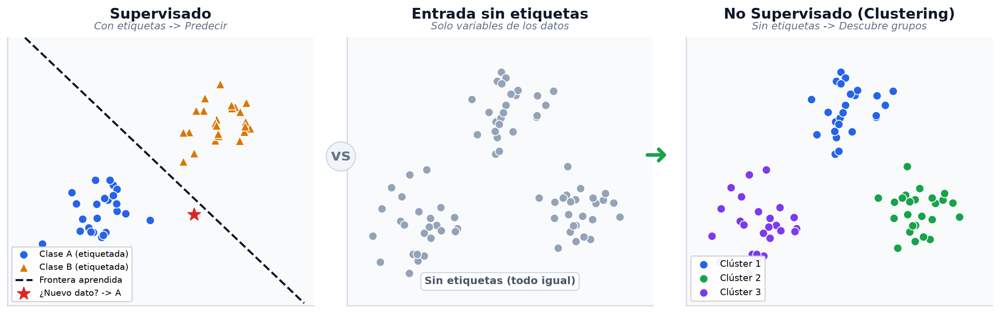
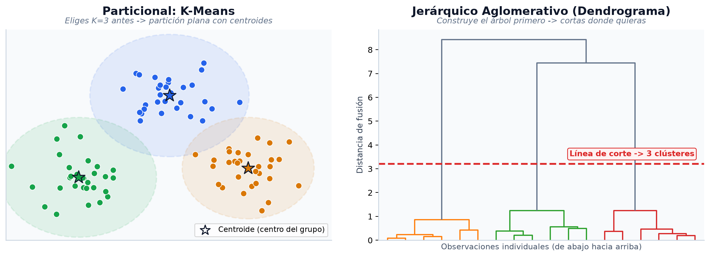
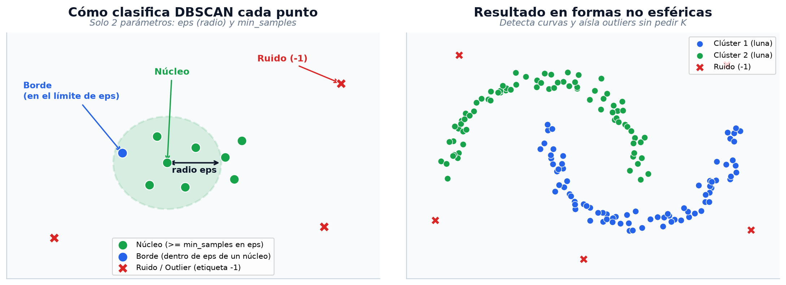
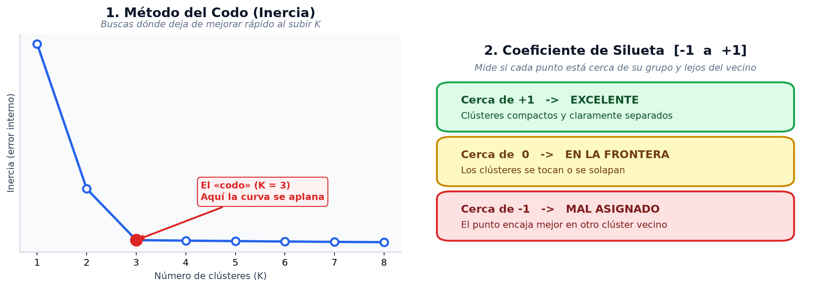
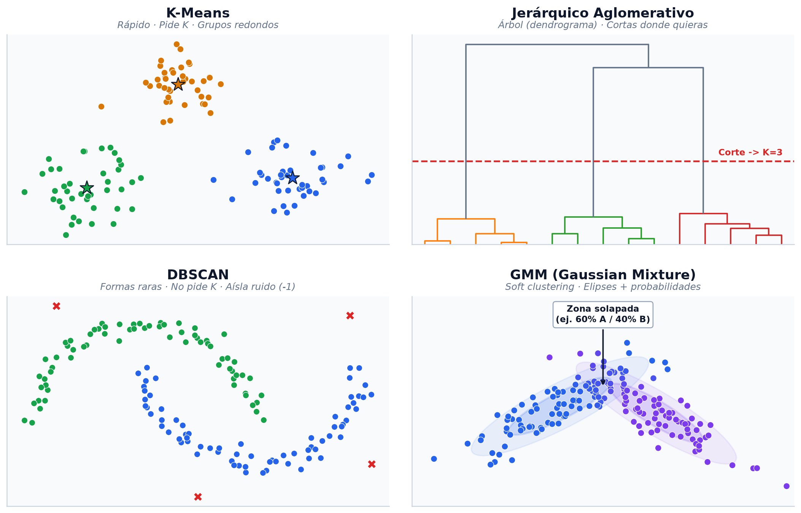
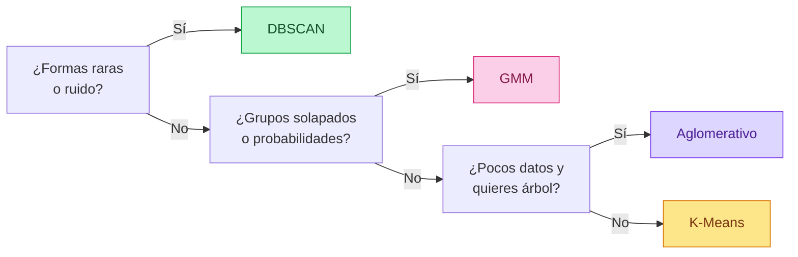

# Algoritmos de Clustering — Guía Esencial desde Cero

> [!NOTE]
> **Cuaderno público con 25 fuentes** *(13 oficiales + 10 vídeos + 2 guías visuales)*.
> Límites de NotebookLM por cuaderno: **Cuenta gratuita: 50** · **Google AI Plus: 100** · **Google AI Pro: 300**. Al tener **25 fuentes**, cualquiera puede abrirlo y **clonarlo gratis**.

## Índice
1. [¿Qué es el aprendizaje no supervisado y el clustering?](#1-aprendizaje-no-supervisado-y-clustering)
2. [Clustering particional (centroides) vs. jerárquico](#2-particional-centroides-vs-jerárquico)
3. [Clustering basado en densidad (DBSCAN)](#3-clustering-basado-en-densidad-dbscan)
4. [Hiperparámetros y métodos de evaluación (Codo y Silueta)](#4-hiperparámetros-y-cómo-evaluar-la-calidad)
5. [Los 4 algoritmos esenciales (K-Means, Aglomerativo, DBSCAN y GMM)](#5-los-4-algoritmos-esenciales)
6. [Referencias](#6-referencias)

---

## 1. Aprendizaje no supervisado y clustering

- **Aprendizaje no supervisado:** el modelo analiza **datos sin etiquetas** y busca patrones por sí solo.
- **Clustering:** técnica que **agrupa datos parecidos** en *clústeres* (muy parecidos dentro del grupo, diferentes entre grupos).
- **Propósito:** descubrir segmentos ocultos sin saber de antemano qué grupos existen *(clientes, anomalías/fraude, recomendación de productos, noticias o pacientes)*.

| | Supervisado | No Supervisado (Clustering) |
| :--- | :--- | :--- |
| **¿Tiene etiquetas?** | **Sí** *(sabemos la respuesta)* | **No** *(solo los datos)* |
| **Objetivo** | **Predecir** un resultado | **Descubrir** grupos naturales |
| **¿Cómo se evalúa?** | Comparando con la respuesta real | Métricas internas (*Codo, Silueta*) + sentido práctico |

> 🎬 **Ver explicado:** [Qué es el clustering — Codificando Bits `03:47`](https://www.youtube.com/watch?v=A5sfobIi4Ag&t=227s)

---

## 2. Particional (centroides) vs. Jerárquico

- **Particional (por centroides):** divide los datos directamente en **$K$ grupos** alrededor de un centro (*centroide*).
  - **Algoritmo típico — K-Means:** colocas $K$ centros, asignas cada punto al centro más cercano y mueves cada centro a la media de su grupo hasta estabilizarse.
- **Jerárquico:** construye un **árbol de grupos (*dendrograma*)** uniendo los datos más cercanos paso a paso; luego **cortas el árbol** a la altura que quieras.
  - **Algoritmo típico — Jerárquico Aglomerativo:** cada dato empieza solo y se van fusionando los pares más parecidos hasta formar un único grupo.

| | Particional (K-Means) | Jerárquico (Aglomerativo) |
| :--- | :--- | :--- |
| **¿Eliges $K$ antes?** | **Sí**, obligatorio | **No**, eliges al cortar el árbol |
| **Forma de salida** | Grupos planos fijos | Árbol (*dendrograma*) |
| **Velocidad** | **Muy rápido** (ideal para muchos datos) | **Lento** en datasets grandes |

> 🧪 **Prueba visual:** [Simulador interactivo K-Means](https://www.naftaliharris.com/blog/visualizing-k-means-clustering/)
> 🎬 **Vídeos al minuto exacto:** [K-Means paso a paso `05:13` (ES)](https://www.youtube.com/watch?v=zZdPa7v321Y&t=313s) · [Cómo leer un dendrograma `24:11` (ES)](https://www.youtube.com/watch?v=hyDOCXMmXxc&t=1451s) · [K-Means vs. Jerárquico `06:06` (EN)](https://www.youtube.com/watch?v=4b5d3muPQmA&t=366s)

---

## 3. Clustering basado en densidad (DBSCAN)

**DBSCAN** agrupa **zonas donde los puntos están muy juntos** y separa lo que queda suelto como **ruido (`-1`)**. Solo usa 2 ajustes:
- **`eps`:** el **radio** que mira alrededor de cada punto.
- **`min_samples`:** cuántos puntos mínimos necesita dentro de ese radio para considerarlo un **núcleo denso**.

### En qué cambia frente a K-Means y Jerárquico
- **Detecta formas raras** *(curvas, lunas, anillos)*, no solo grupos redondos.
- **No te pide $K$:** descubre cuántos grupos hay automáticamente.
- **Ignora el ruido:** etiqueta los *outliers* como `-1` en vez de mezclarlos a la fuerza.

> [!WARNING]
> **Su punto débil:** le cuesta separar grupos si unos son muy densos y otros muy dispersos.

> 🧪 **Prueba visual:** [Simulador interactivo DBSCAN](https://www.naftaliharris.com/blog/visualizing-dbscan-clustering/)
> 🎬 **Vídeos al minuto exacto:** [DBSCAN paso a paso `03:21` (ES)](https://www.youtube.com/watch?v=HMis89lGdkA&t=201s) · [Qué problemas resuelve `01:01` (EN)](https://www.youtube.com/watch?v=RDZUdRSDOok&t=61s)

---

## 4. Hiperparámetros y cómo evaluar la calidad

Como **no hay respuestas correctas** con las que comparar, elegir mal los parámetros arruina el resultado:
- **$K$ muy bajo** mezcla grupos distintos; **$K$ muy alto** rompe un grupo real en trozos artificiales.
- **`eps` muy pequeño** marca todo como ruido; **`eps` muy grande** junta todo en 1 solo grupo.

### Los 2 métodos esenciales de evaluación
1. **Método del Codo *(Inercia)*:** mide qué tan apretados están los puntos alrededor de su centroide. Probamos varios $K$ y elegimos el punto donde la curva hace un **"codo"** y deja de bajar rápido.
2. **Coeficiente de Silueta *(de `-1` a `+1`)*:** mide si cada punto está **cerca de su grupo** y **lejos del grupo vecino**.
   - **Cerca de `+1`:** excelente · **Cerca de `0`:** grupos solapados · **Negativo (`-1`):** mal asignado.

> [!TIP]
> **Consejo práctico:** usa **Codo + Silueta juntos** y comprueba siempre si los grupos tienen sentido real.

> 🎬 **Vídeos al minuto exacto:** [Cómo leer el Método del Codo `04:26` (EN)](https://www.youtube.com/watch?v=4b5d3muPQmA&t=266s) · [Coeficiente de Silueta `05:09` (ES)](https://www.youtube.com/watch?v=b920s9nXGao&t=309s)

---

## 5. Los 4 algoritmos esenciales

### K-Means
- **Cómo funciona:** busca $K$ centros (*centroides*) moviéndolos a la media de sus puntos más cercanos para minimizar la **inercia**.
- **✅ Ventajas:** muy rápido, sencillo y escala a millones de datos.
- **⚠️ Desventajas:** exige elegir $K$, solo funciona bien con grupos redondos y le afectan mucho los *outliers*.
- **🎯 Uso común:** segmentación de clientes y compresión de imágenes.

### Clustering Jerárquico (Aglomerativo)
- **Cómo funciona:** empieza con cada punto separado y une paso a paso los grupos más cercanos *(criterio de linkage, ej. Ward)* formando un **dendrograma**.
- **✅ Ventajas:** no exige elegir $K$ antes y permite ver la jerarquía completa.
- **⚠️ Desventajas:** lento y pesado con muchos datos; una unión temprana no se puede deshacer.
- **🎯 Uso común:** taxonomías, bioinformática y datasets pequeños o medianos.

### DBSCAN
- **Cómo funciona:** conecta **puntos núcleo** según el radio **`eps`** y **`min_samples`**; deja la periferia como **borde** y los puntos aislados como **ruido (`-1`)**.
- **✅ Ventajas:** encuentra cualquier forma, no pide $K$ y detecta *outliers* solo.
- **⚠️ Desventajas:** sensible a `eps` y falla si los grupos tienen densidades muy distintas.
- **🎯 Uso común:** datos geográficos y detección de anomalías.

### Gaussian Mixture Models (GMM)
- **Cómo funciona:** modelo probabilístico (**soft clustering**) que ajusta varias campanas gaussianas *(algoritmo **EM**)* y asigna a cada punto la **probabilidad** de pertenecer a cada grupo *(ej. 70 % A / 30 % B)*.
- **✅ Ventajas:** maneja **grupos solapados** y formas **elípticas** (no solo círculos).
- **⚠️ Desventajas:** más lento que K-Means, pide elegir $K$ *(orientable con BIC/AIC)* y asume datos con forma gaussiana.
- **🎯 Uso común:** perfiles híbridos con solapamiento y detección probabilística de anomalías.
- 🎬 **Ver GMM al minuto exacto:** [Hard vs. Soft clustering `01:56` (EN)](https://www.youtube.com/watch?v=q71Niz856KE&t=116s) · [K-Means vs. GMM `00:30` (EN)](https://www.youtube.com/watch?v=wT2yLNUfyoM&t=30s)

---

### Resumen rápido y regla de elección

| Algoritmo | ¿Pide $K$? | Formas | Ruido (*outliers*) | Velocidad |
| :--- | :---: | :--- | :--- | :--- |
| **K-Means** | **Sí** | Redondas | 🔴 Sensible | ⚡ Muy alta |
| **Aglomerativo** | **No** *(al cortar)* | Compactas | 🟡 Moderado | 🐢 Baja |
| **DBSCAN** | **No** | **Cualquiera** | 🟢 **Lo aísla (`-1`)** | 🚀 Media-alta |
| **GMM** | **Sí** | **Elipses / solapadas** | 🟡 Baja probabilidad | ⚙️ Media |

---

## 6. Referencias

- **Oficiales:** [scikit-learn Clustering](https://scikit-learn.org/stable/modules/clustering.html) · [scikit-learn GMM](https://scikit-learn.org/stable/modules/mixture.html) · [Google ML Clustering](https://developers.google.com/machine-learning/clustering/overview) · [IBM Clustering](https://www.ibm.com/think/topics/clustering) · [Wikipedia DBSCAN](https://en.wikipedia.org/wiki/DBSCAN)
- **Visuales y vídeos:** [Codificando Bits](https://www.youtube.com/watch?v=A5sfobIi4Ag&t=227s) · [Código Máquina](https://www.youtube.com/watch?v=HMis89lGdkA&t=201s) · [StatQuest](https://www.youtube.com/watch?v=4b5d3muPQmA&t=266s) · [Luis Serrano](https://www.youtube.com/watch?v=q71Niz856KE&t=116s) · [DataMListic](https://www.youtube.com/watch?v=wT2yLNUfyoM&t=30s) · [Naftali Harris (K-Means / DBSCAN)](https://www.naftaliharris.com/blog/visualizing-k-means-clustering/)
