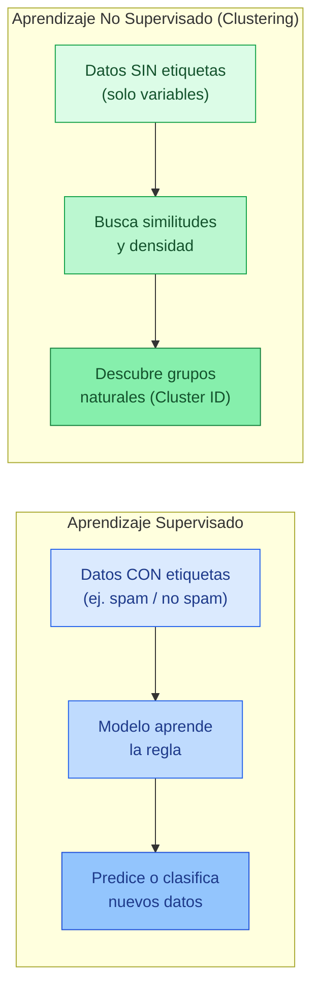
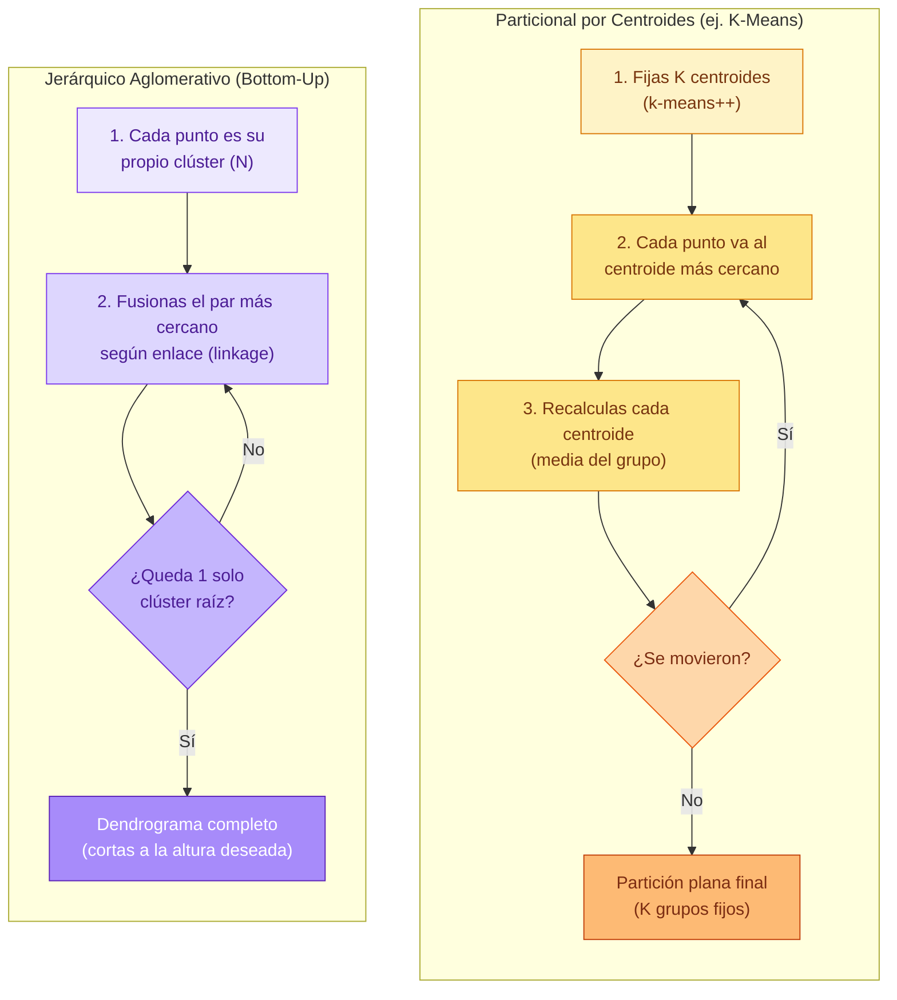
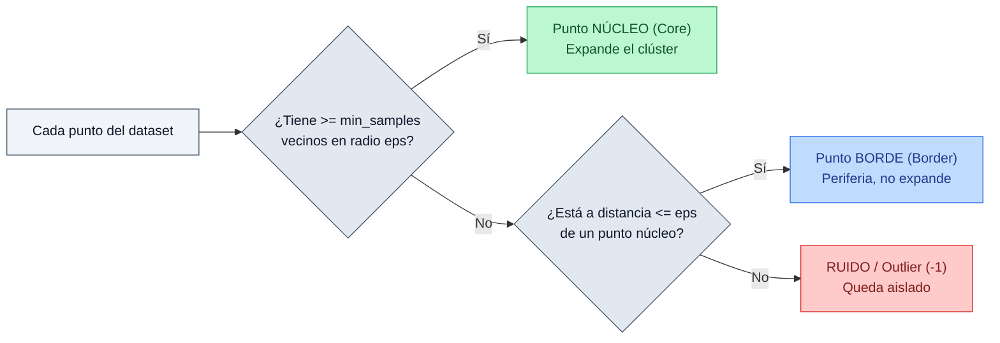
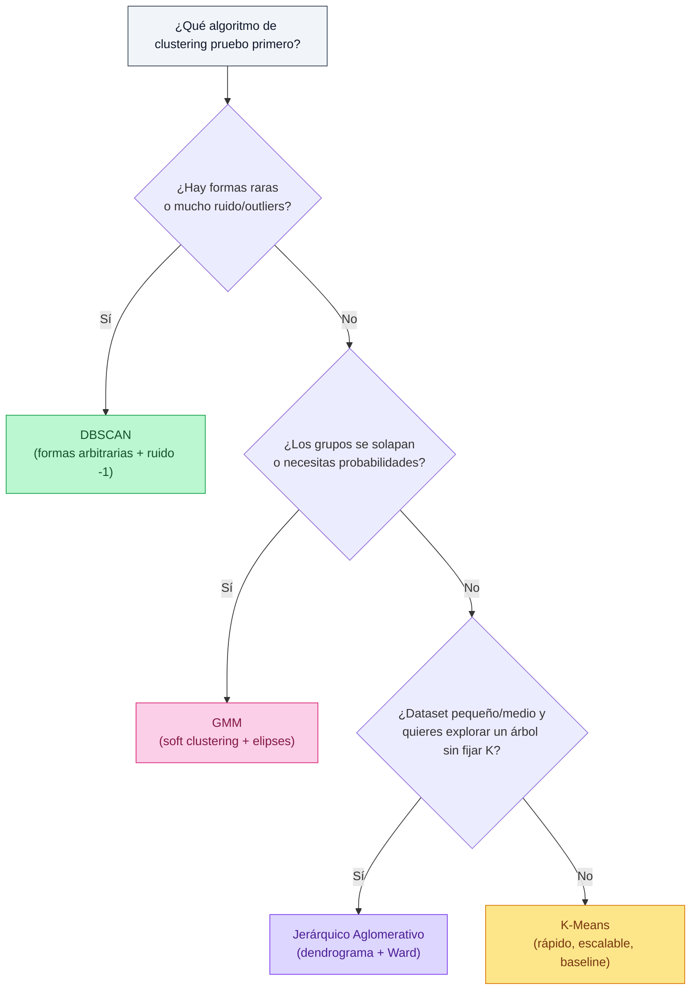

# Algoritmos de Clustering — Guía Visual desde Cero

Guía **concisa y visual** sobre **aprendizaje no supervisado y clustering**, centrada en lo más crítico que necesitas dominar en una primera toma de contacto.

> [!NOTE]
> **Sobre el cuaderno público de NotebookLM (25 fuentes: 13 oficiales + 10 vídeos + 2 guías visuales):**
> Límites orientativos de fuentes por cuaderno según plan de Google: **Cuenta gratuita (*Free*): 50** · **Google AI Plus: 100** · **Google AI Pro: 300**. Al contener **25 fuentes**, cualquier alumno puede abrirlo, consultarlo y **clonarlo** incluso con una cuenta gratuita.

### Índice rápido
[1. No supervisado vs. Supervisado](#1-aprendizaje-no-supervisado-y-clustering) · [2. Particional vs. Jerárquico](#2-clustering-particional-centroides-vs-jerárquico) · [3. Densidad (DBSCAN)](#3-clustering-basado-en-densidad-dbscan) · [4. Hiperparámetros y Evaluación](#4-hiperparámetros-y-métricas-de-evaluación) · [5. Los 4 Algoritmos](#5-fichas-rápidas-de-algoritmos) · [6. Referencias](#6-referencias)

---

## 1. Aprendizaje no supervisado y clustering

- **Aprendizaje no supervisado:** rama del *Machine Learning* que trabaja con **datos sin etiquetas** (*unlabeled data*) para descubrir patrones ocultos sin intervención humana.
- **Clustering (agrupamiento):** técnica no supervisada que agrupa datos parecidos en **clústeres** (*alta similitud interna, baja similitud entre grupos*) y asigna un *cluster ID* a cada dato.
  - ***Hard clustering* (rígido):** cada dato pertenece a **1 solo grupo** *(ej. K-Means)*.
  - ***Soft clustering* (probabilístico):** cada dato tiene una **probabilidad de pertenencia** a varios grupos *(ej. GMM)*.

| Criterio | Supervisado | No Supervisado (Clustering) |
| :--- | :--- | :--- |
| **Etiquetas** | **Sí** (*ground truth* conocido). | **No** (solo variables de entrada). |
| **Objetivo** | **Predecir** un valor o clase futura. | **Descubrir** grupos y estructuras ocultas. |
| **Evaluación** | Directa contra la etiqueta real (*accuracy*, error). | **Métricas internas** (Codo, Silueta) + **sentido de negocio**. |

> [!IMPORTANT]
> **¿Para qué sirve en el mundo real?** **Segmentar clientes** (marketing), **detectar anomalías/fraude**, **recomendar productos**, **agrupar noticias/documentos**, **segmentar imágenes** y **estratificar pacientes o secuencias genéticas**.

> 🎬 **Recurso visual:** [El CLUSTERING en el Machine Learning ¡EXPLICADO! — Codificando Bits (ES)](https://www.youtube.com/watch?v=A5sfobIi4Ag)

---

## 2. Clustering particional (centroides) vs. jerárquico

Son dos formas opuestas de organizar los datos: **división plana rápida** frente a **árbol de grupos anidados**.

| Diferencia clave | Particional (Centroides) | Jerárquico |
| :--- | :--- | :--- |
| **Resultado** | **Partición plana** en $K$ grupos disjuntos. | **Árbol multinivel** (*dendrograma*) de grupos anidados. |
| **¿Eliges $K$ antes?** | **Sí, obligatorio** antes de ejecutar. | **No:** construyes el árbol y luego eliges dónde cortar. |
| **Enfoque** | Minimiza distancia a centros (inercia). | **Aglomerativo** (*bottom-up*, el más común) o **Divisivo** (*top-down*). |
| **Criterio de unión** | Distancia punto → centroide. | ***Linkage*:** *Ward* (compactos), *Complete* (máx.), *Average* (media), *Single* (mín., riesgo de *chaining*). |
| **Velocidad / Escala** | **Muy rápido** — $O(n)$ por iteración. | **Costoso** — $O(n^2)$ en tiempo y memoria. |
| **Algoritmo tipo** | **K-Means** | **Clustering Jerárquico Aglomerativo** |

> 🧪 **Pruébalo en directo:** [Simulador interactivo de K-Means — Naftali Harris](https://www.naftaliharris.com/blog/visualizing-k-means-clustering/)
> 🎬 **Vídeos paso a paso:** [K-Means (Codificando Bits, ES)](https://www.youtube.com/watch?v=zZdPa7v321Y) · [K-Means (StatQuest, EN)](https://www.youtube.com/watch?v=4b5d3muPQmA) · [Dendrogramas (Código Máquina, ES)](https://www.youtube.com/watch?v=hyDOCXMmXxc) · [Hierarchical (StatQuest, EN)](https://www.youtube.com/watch?v=7xHsRkOdVwo)

---

## 3. Clustering basado en densidad (DBSCAN)

**DBSCAN** (*Density-Based Spatial Clustering of Applications with Noise*) define un clúster como una **región densa de puntos separada por zonas vacías**. Funciona con solo **2 hiperparámetros**:

- **`eps` ($\varepsilon$):** **radio** de vecindad alrededor de cada punto.
- **`min_samples` ($MinPts$):** **mínimo de puntos** necesarios dentro del radio `eps` (incluido él mismo) para considerar la zona *densa*.

### ¿En qué se diferencia de Centroides y Jerárquico?

| Aspecto | DBSCAN (Densidad) | K-Means (Centroides) | Jerárquico |
| :--- | :--- | :--- | :--- |
| **Formas que detecta** | **Cualquier forma** (lunas, anillos, curvas). | Solo **esféricas / convexas**. | Depende del *linkage* (*Ward* = compactas). |
| **¿Pide $K$ antes?** | **No**, descubre cuántos grupos hay solo. | **Sí**, obligatorio. | No para el árbol, sí para el corte. |
| **Ruido / *Outliers*** | **Los aísla nativamente (`-1`)**. | Los mete a la fuerza y **deforman el centroide**. | Pueden unir grupos por error (*single linkage*). |

> [!WARNING]
> **Punto débil de DBSCAN:** al usar un único `eps` global, **sufre si hay clústeres con densidades muy distintas** entre sí *(para eso existen OPTICS o HDBSCAN)*.

> 🧪 **Pruébalo en directo:** [Simulador interactivo de DBSCAN — Naftali Harris](https://www.naftaliharris.com/blog/visualizing-dbscan-clustering/)
> 🎬 **Vídeos paso a paso:** [DBSCAN paso a paso (Código Máquina, ES)](https://www.youtube.com/watch?v=HMis89lGdkA) · [DBSCAN Clearly Explained (StatQuest, EN)](https://www.youtube.com/watch?v=RDZUdRSDOok)

---

## 4. Hiperparámetros y métricas de evaluación

### ¿Por qué es tan crítico elegir bien $K$ o los hiperparámetros?
Sin etiquetas reales que corrijan el error, **los hiperparámetros definen el resultado**:
- **$K$ muy bajo:** mezcla grupos diferentes (*subsegmentación*). **$K$ muy alto:** parte en trozos artificiales un grupo natural (*sobresegmentación*).
- **`eps` muy pequeño en DBSCAN:** todo acaba etiquetado como ruido (`-1`). **`eps` muy grande:** todo se fusiona en **1 solo megaclúster**.

### Dos métricas clave que debes dominar primero

| Método / Métrica | Qué mide exactamente | Cómo interpretarlo | Cuidado con... |
| :--- | :--- | :--- | :--- |
| **1. Método del Codo** *(usa **Inercia / WCSS**)* | Suma de distancias al cuadrado de cada punto a su centroide *(compacidad interna)*: $\text{Inercia} = \sum_{i} \|x_i - \mu_j\|^2$ | Graficas Inercia vs. $K$ y buscas el **"codo"** donde la curva deja de bajar rápido y se aplana. | Siempre baja hasta `0` cuando $K = N$; en datos reales el codo puede ser **subjetivo**. |
| **2. Coeficiente de Silueta** *(Silhouette Score)* | Compara **cohesión interna** ($a$, distancia a tu grupo) vs. **separación** ($b$, distancia al grupo vecino): $s = \frac{b - a}{\max(a, b)}$ | Rango **$[-1, +1]$**: cuanto más cerca de **`+1`**, mejor agrupado y separado. | Favorece grupos **convexos** (suele puntuar peor a DBSCAN en formas raras). |

**Escala rápida del Coeficiente de Silueta:**

| Valor de Silueta | Significado visual |
| :---: | :--- |
| 🔴 **Cerca de `-1`** | **Mal asignado:** el punto está más cerca de otro clúster que del suyo. |
| 🟡 **Cerca de `0`** | **En la frontera:** clústeres solapados o ambiguos. |
| 🟢 **Cerca de `+1`** | **Óptimo:** clúster compacto y claramente separado de los vecinos. |

> [!TIP]
> **Regla práctica de principiante:** no confíes solo en el Codo; **combina Codo + Silueta** (y revisa si los grupos tienen sentido para el negocio).
> *Otras métricas útiles más adelante:* **Calinski-Harabasz** *(mayor = mejor)*, **Davies-Bouldin** *(cerca de 0 = mejor)* y **BIC / AIC** *(menor = mejor, estándar en GMM)*.

> 🎬 **Vídeos y gráficos:** [Métricas Silueta y Davies-Bouldin (Código Máquina, ES)](https://www.youtube.com/watch?v=b920s9nXGao) · [Análisis visual de Silueta — scikit-learn](https://scikit-learn.org/stable/auto_examples/cluster/plot_kmeans_silhouette_analysis.html)

---

## 5. Fichas rápidas de algoritmos

### 5.1. K-Means
- **Cómo funciona:** *hard clustering* que minimiza la **inercia** alternando: *(1)* asignar cada punto al centroide más cercano y *(2)* recalcular el centroide como la media del grupo *(con inicialización `k-means++`)*.
- **✅ Ventajas:** muy rápido y escalable ($O(n)$, admite *MiniBatchKMeans*); simple e intuitivo.
- **⚠️ Desventajas:** exige fijar **$K$**, solo funciona bien con **formas esféricas**, muy sensible a ***outliers*** y a escalas sin normalizar.
- **🎯 Cuándo usarlo:** segmentación de clientes, compresión de imágenes, datasets grandes numéricos.
- 🎬 **Ver visual:** [Simulador K-Means](https://www.naftaliharris.com/blog/visualizing-k-means-clustering/) · [StatQuest](https://www.youtube.com/watch?v=4b5d3muPQmA)

### 5.2. Clustering Jerárquico (Aglomerativo)
- **Cómo funciona:** enfoque *bottom-up* que empieza con cada punto aislado y fusiona iterativamente el par más cercano según el criterio de ***linkage*** (*Ward, Complete, Average, Single*) hasta crear un **dendrograma**.
- **✅ Ventajas:** **no exige elegir $K$ de antemano**; visión multiescala en árbol; admite varias métricas de distancia (*Manhattan, coseno*).
- **⚠️ Desventajas:** **lento y pesado en memoria** ($O(n^2)$); decisiones *greedy* irreversibles; *single linkage* sufre encadenamiento con ruido.
- **🎯 Cuándo usarlo:** datasets pequeños/medianos, bioinformática y taxonomías, agrupación de variables (*feature agglomeration*).
- 🎬 **Ver visual:** [Dendrogramas — Código Máquina (ES)](https://www.youtube.com/watch?v=hyDOCXMmXxc) · [StatQuest (EN)](https://www.youtube.com/watch?v=7xHsRkOdVwo)

### 5.3. DBSCAN
- **Cómo funciona:** agrupa regiones densas conectando **puntos núcleo** definidos por **`eps`** y **`min_samples`**, dejando márgenes como **borde** y puntos aislados como **ruido (`-1`)**.
- **✅ Ventajas:** detecta **formas arbitrarias** (curvas, anillos), **no pide $K$**, aísla ***outliers*** automáticamente, rápido con índices espaciales ($O(n \log n)$).
- **⚠️ Desventajas:** falla con **densidades muy distintas**, sensible a elegir bien `eps`, pierde fuerza en muy alta dimensión.
- **🎯 Cuándo usarlo:** datos geoespaciales, detección de anomalías/ruido, formas complejas no esféricas.
- 🎬 **Ver visual:** [Simulador DBSCAN](https://www.naftaliharris.com/blog/visualizing-dbscan-clustering/) · [Código Máquina (ES)](https://www.youtube.com/watch?v=HMis89lGdkA)

### 5.4. Gaussian Mixture Models (GMM)
- **Cómo funciona:** modelo probabilístico (**soft clustering**) que asume que los datos nacen de una mezcla de **distribuciones gaussianas**. Usa el algoritmo **EM (*Expectation-Maximization*)** para calcular la **probabilidad de pertenencia** de cada punto a cada clúster y ajustar medias y **matrices de covarianza** (*spherical, diag, tied, full*).
- **✅ Ventajas:** da **probabilidades** (maneja grupos solapados), modela **elipses estiradas y rotadas**, permite elegir $K$ con **BIC/AIC**.
- **⚠️ Desventajas:** asume forma gaussiana, más costoso que K-Means, riesgo de **singularidades** si un grupo tiene muy pocos datos.
- **🎯 Cuándo usarlo:** grupos elípticos o solapados (perfiles híbridos), estimación de densidad, detección probabilística de anomalías.
- 🎬 **Ver visual:** [Luis Serrano Academy (EN)](https://www.youtube.com/watch?v=q71Niz856KE) · [DataMListic Animado (EN)](https://www.youtube.com/watch?v=wT2yLNUfyoM)

---

### 5.5. Comparativa de un vistazo y guía rápida de elección

| Algoritmo | Tipo | ¿Pide $K$? | Formas | *Outliers* | Velocidad |
| :--- | :--- | :---: | :--- | :--- | :--- |
| **K-Means** | Centroides (*hard*) | **Sí** | Esféricas | 🔴 Muy sensible | ⚡ Muy alta — $O(n)$ |
| **Aglomerativo** | Jerárquico (*árbol*) | **No** *(al cortar)* | Compactas (*Ward*) | 🟡 Sensible (*single*) | 🐢 Baja — $O(n^2)$ |
| **DBSCAN** | Densidad (*hard* + ruido) | **No** | **Arbitrarias** | 🟢 **Excelente (`-1`)** | 🚀 Media-alta — $O(n \log n)$ |
| **GMM** | Probabilístico (*soft*) | **Sí** *(BIC/AIC)* | **Elipses** / solapadas | 🟡 Vía baja densidad | ⚙️ Media (EM) |

> 📊 **Comparación visual definitiva:** [Matriz de 6 geometrías × algoritmos (scikit-learn)](https://scikit-learn.org/stable/auto_examples/cluster/plot_cluster_comparison.html) · [Algoritmos paso a paso con GIFs (David Sheehan)](https://dashee87.github.io/data%20science/general/Clustering-with-Scikit-with-GIFs/)

---

## 6. Referencias

- **Documentación oficial (13 fuentes en NotebookLM):** [scikit-learn Clustering](https://scikit-learn.org/stable/modules/clustering.html) · [scikit-learn GMM](https://scikit-learn.org/stable/modules/mixture.html) · [Silhouette Analysis](https://scikit-learn.org/stable/auto_examples/cluster/plot_kmeans_silhouette_analysis.html) · [Demo DBSCAN](https://scikit-learn.org/stable/auto_examples/cluster/plot_dbscan.html) · [GMM Selection (BIC)](https://scikit-learn.org/stable/auto_examples/mixture/plot_gmm_selection.html) · [Google ML Supervised](https://developers.google.com/machine-learning/intro-to-ml/supervised) · [Google ML Clustering](https://developers.google.com/machine-learning/clustering/overview) · [Google ML Algorithms](https://developers.google.com/machine-learning/clustering/clustering-algorithms) · [IBM Unsupervised](https://www.ibm.com/think/topics/unsupervised-learning) · [IBM Clustering](https://www.ibm.com/think/topics/clustering) · [IBM K-Means](https://www.ibm.com/think/topics/k-means-clustering) · [IBM Hierarchical](https://www.ibm.com/think/topics/hierarchical-clustering) · [Wikipedia DBSCAN](https://en.wikipedia.org/wiki/DBSCAN)
- **Vídeos y guías visuales (12 fuentes en NotebookLM + 2 simuladores):** [Codificando Bits (Clustering)](https://www.youtube.com/watch?v=A5sfobIi4Ag) · [Codificando Bits (K-Means)](https://www.youtube.com/watch?v=zZdPa7v321Y) · [Código Máquina (Jerárquico)](https://www.youtube.com/watch?v=hyDOCXMmXxc) · [Código Máquina (DBSCAN)](https://www.youtube.com/watch?v=HMis89lGdkA) · [Código Máquina (Silueta)](https://www.youtube.com/watch?v=b920s9nXGao) · [StatQuest (K-Means)](https://www.youtube.com/watch?v=4b5d3muPQmA) · [StatQuest (Hierarchical)](https://www.youtube.com/watch?v=7xHsRkOdVwo) · [StatQuest (DBSCAN)](https://www.youtube.com/watch?v=RDZUdRSDOok) · [Luis Serrano (GMM)](https://www.youtube.com/watch?v=q71Niz856KE) · [DataMListic (GMM)](https://www.youtube.com/watch?v=wT2yLNUfyoM) · [scikit-learn Cluster Comparison](https://scikit-learn.org/stable/auto_examples/cluster/plot_cluster_comparison.html) · [Clustering with GIFs](https://dashee87.github.io/data%20science/general/Clustering-with-Scikit-with-GIFs/) · [Simulador K-Means](https://www.naftaliharris.com/blog/visualizing-k-means-clustering/) · [Simulador DBSCAN](https://www.naftaliharris.com/blog/visualizing-dbscan-clustering/)
